# Регистрация в качестве самозанятого и работа в приложении «Мой Налог»
> [!IMPORTANT]
> Если вы оказываете услуги (например, фриланс, репетиторство, сдача жилья), оформите самозанятость. **Так вы будете работать официально:** клиенты смогут с вами сотрудничать без рисков, а у налоговой не возникнет вопросов.

## Что дает статус самозанятого

Вы становитесь **плательщиком налога на профессиональный доход (НПД):**
- **4 %** — если получаете оплату от физлиц;
- **6 %** — если работаете с юрлицами и ИП.
Всё ведётся в приложении **Мой Налог:** вы выставляете счета и чеки, платите налог, получаете справки. Расчёты идут автоматически — бухгалтер не нужен.

## Что нельзя делать на НПД 
> [!WARNING]
> Перед тем как начать, сверьте свою деятельность со списком запретов — нарушение любого из них ведёт к **потере статуса НПД.**

**Самозанятым нельзя:**
- перепродавать **чужие** товары;
- продавать **подакцизные или маркированные** товары;
- добывать и продавать **полезные ископаемые**;
- работать по **агентским, комиссионным и договорам поручения**;
- заниматься **майнингом** и операциями с **цифровой валютой**;
- сдавать в аренду **нежилые помещения**;
- оказывать услуги **текущему или бывшему работодателю** (если с увольнения прошло менее двух лет);
- **совмещать НПД** с другими налоговыми режимами;
- нанимать сотрудников по **трудовым договорам.**

## Какие еще есть нюансы оформления самозанятости

- **Лимит дохода — 2,4 млн рублей в год.** Это относится только к доходу за профессиональную деятельность, по которой вы выставляется счета. Личные переводы (зарплата, возврат долга, продажа личного имущества) не влияют на лимит.
- **Доработка товара — не перепродажа.** Если вы изменили вещь (например, расписали кружку или сшили из ткани изделие), это считается продуктом собственного производства — продавать можно.
- **Риск переквалификации в трудовые отношения.** Регулярные выплаты в одни и те же даты, работа на одном месте заказчика и отсутствие актов могут вызвать вопросы налоговой. Лучше фиксировать результат актом и избегать признаков «скрытой зарплаты».
- **Сроки формирования чека.** При наличной оплате чек нужен сразу, при безналичной — не позднее 9‑го числа месяца, следующего за месяцем поступления денег.
- **Нет страхового стажа.** Работа на НПД не засчитывается в пенсионный стаж — его можно формировать только через добровольные взносы в СФР.

## Регистрация в приложении Мой Налог

Процесс регистрации в качестве самозанятого осуществляется одним из следующих способов:
- через **мобильное приложение ФНС России «Мой налог»**;
- через **личный веб-кабинет «Мой налог»,** размещенный на сайте ФНС России;
- через **любую кредитную организацию или банк,** осуществляющие информационное взаимодействие с ФНС России;
- через **Единый портал госуслуг.**

Подробная информация о регистрации в качестве самозанятого и работе в приложении Мой Налог указана на [сайте ФНС](https://npd.nalog.ru/app/). Рассмотрим регистрацию в приложении с авторизацией через Госуслуги. 

Скачайте приложение в [GooglePlay](https://play.google.com/store/apps/details?id=com.gnivts.selfemployed&hl=ru) или [AppStore](https://apps.apple.com/ru/app/мой-налог/id1437518854?l=en-GB).

 

Откройте приложение и нажмите **Далее**, нажмите **Согласен**, чтобы подтвердить согласие с Соглашением на обработку персональных данных и Правилами пользования приложением. На третьем экране выберите **Стать самозанятым.** 
 
 
 
 
 

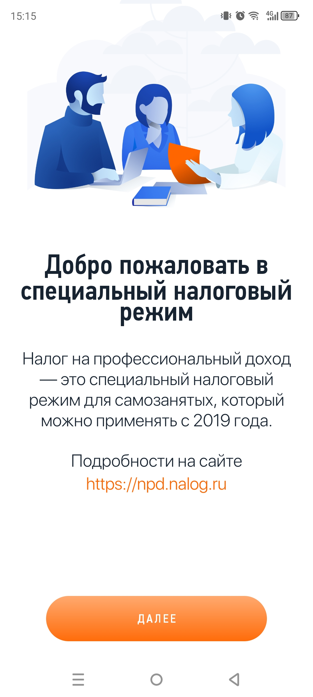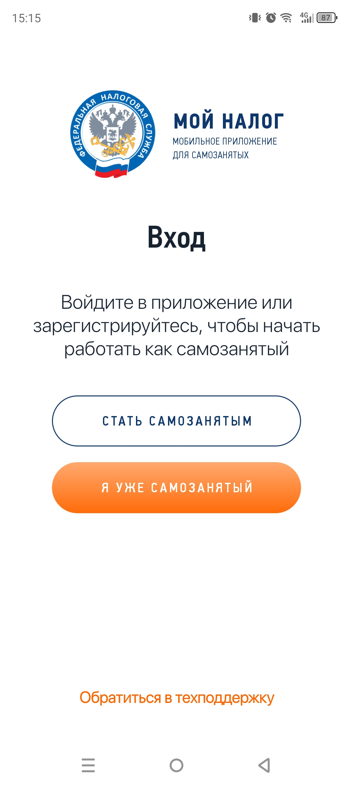

 
Выберите способ авторизации __Через портал Госуслуг__. Вы будете направлены на окно ввода __логина и пароля для портала Госуслуг__. После авторизации на портале, вы вернетесь в приложение Мой Налог, и вам будет предложено установить __пин-код__ для входа.
 
 

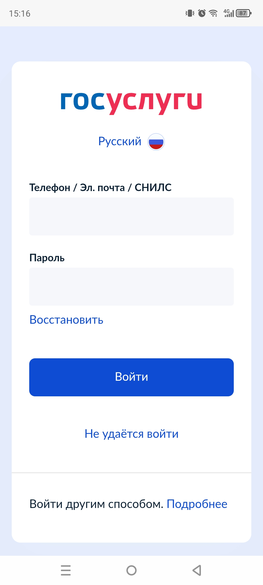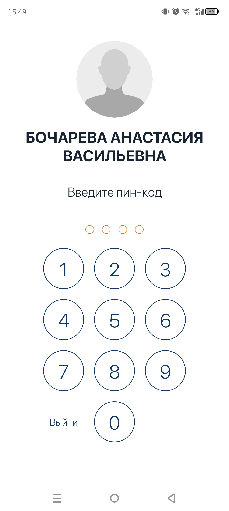

Ваше заявление на регистрацию в качестве плательщика НПД принято в работу. Срок обработки заявления **до 5 рабочих дней.** На практике — быстрее, от нескольких минут до нескольких часов.
 
 
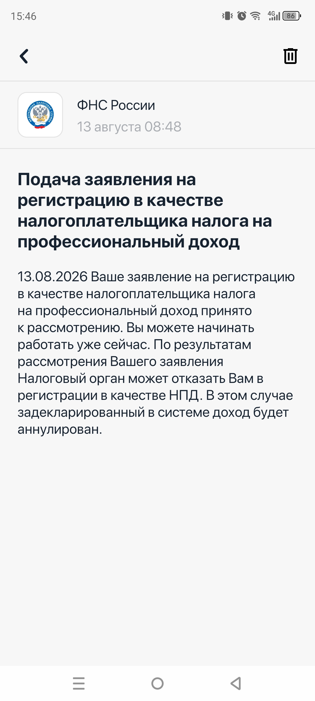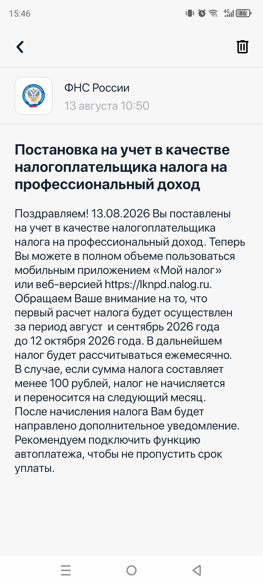
 
 
 
 
 
 
 
 
 
 
 
 
 
 
 
 
 
 
 
 
 
 
 
 
 
 
 
 
 

## Работа в приложении Мой Налог
### Как начать принимать платежи

Перед тем как выставлять счёт, укажите, куда будете **получать деньги:**
1. Откройте раздел **Прочее** (в правом нижнем углу) → **Платежи**.
2. В блоке **Получение средств** выберите **По расчётному счёту**.
3. Если планируете получать оплату на карту **физлица,** всё равно выберите **По расчётному счёту** и укажите данные **лицевого счёта физического лица.**
4. Введите реквизиты — **БИК и номер счёта** — их можно взять в приложении вашего банка.
5. Нажмите **Сохранить.**

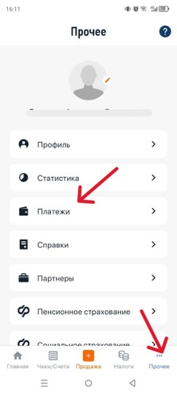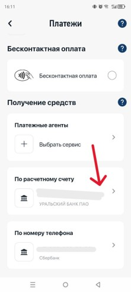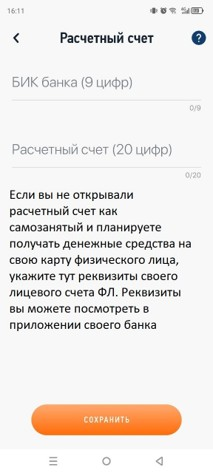

### Как выставить счёт клиенту
1. На главном экране нажмите оранжевую кнопку **+ Продажа.**
2. Укажите **название услуги** (например, монтаж печи Абат) и **стоимость.**
3. Выберите, **кому выставляете счет** — Физическому лицу или Юридическому лицу или ИП.
4. Если выбрали Юридическое лицо или ИП, введите **ИНН компании** и нажмите **Найти** — система подтянет название организации.
5. Нажмите **Выдать счёт.**

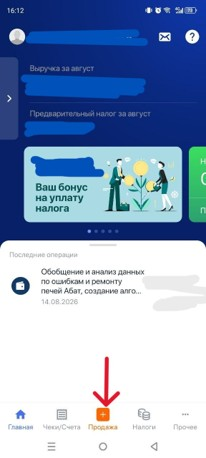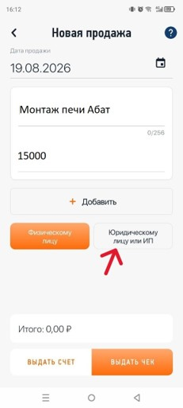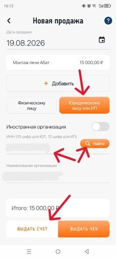

### Как отправить ссылку на счёт

1. Перейдите в **Чеки/Счета** → **Счета** и откройте нужный счёт.
2. Нажмите на **три точки** внизу посередине и выберите **Отправить ссылку на счёт.**
3. Скопируйте ссылку и отправьте клиенту (например, в мессенджер или на почту).

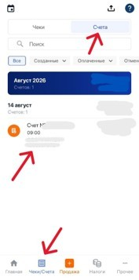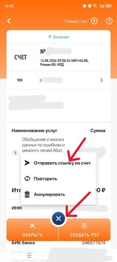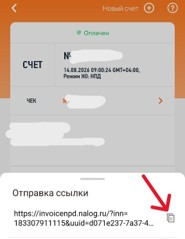

### Как оформить чек после оплаты
 
**Когда клиент оплатит счёт:**
1. Зайдите в **Чеки/Счета** → **Счета** и откройте оплаченный счёт.
2. Нажмите на **три точк**и и выберите **Сформировать чек** или **Отметить оплаченным.** Чек будет создан автоматически.
3. Чтобы **отправить чек,** перейдите в **Чеки/Счета** → **Чеки,** откройте чек и нажмите **Отправить.**
4. Выберите **Отправить ссылку на чек,** скопируйте её и перешлите клиенту.

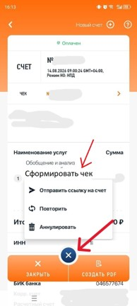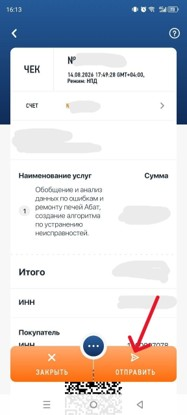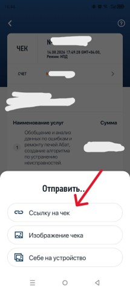

### Как оплатить налог

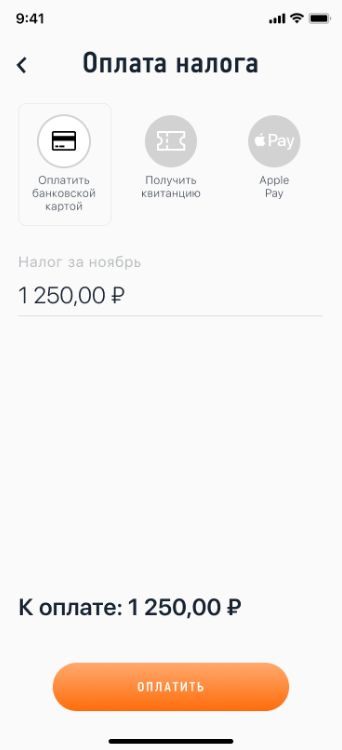

Налог рассчитывается автоматически до 12 числа месяца, следующим за месяцем ведения деятельности. **Первый расчет налога осуществляется за 2 первых месяца работы в качестве самозанятого.** 

То есть, при регистрации в августе 2026 года, первый расчет налога будет произведен до 12 октября 2026 года. В дальнейшем будет происходить ежемесячный расчет. **Оплатить налог необходимо не позднее 28-го числа месяца, следующего за отчётным.**

В случае, если сумма налога составляет менее 100 рублей, налог не начисляется и переносится на следующий месяц. После начисления налога направляется дополнительное уведомление. Можно подключить функцию автоплатежа, чтобы не пропустить срок уплаты.

Когда налог будет рассчитан, вам придет уведомление в приложении Мой Налог. На главном экране отобразится сумма к оплате. Можно оплатить банковской картой или по квитанции.

 
 
 
 
 
 
 
 
 
 
 
 
 

### Как сформировать справку
Налогоплательщики налога на профессиональный доход могут **подтверждать свои доходы** при получении кредита оформлении пособий и в других случаях. В приложении формируются две справки: **о регистрации в качестве самозанятого и доходах за любой период.** Справку можно отправить на электронную почту. 

Кроме справки о постановке на учет, регистрацию можно также проверить с помощью специального [сервиса](https://npd.nalog.ru/check-status/) проверки статуса налогоплательщика.

**Для формирования справки:**
1. Перейдите в раздел **Прочее → Справки.**
2. Выберите необходимую справку — **О постановке на учет или О доходах.**
3. Выберите **год.**
4. Выберите **приложение,** для открытия справки.

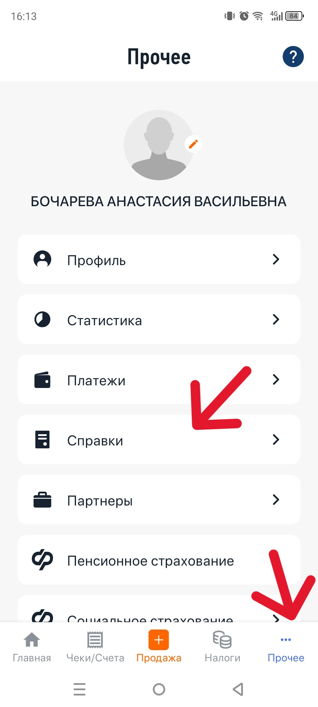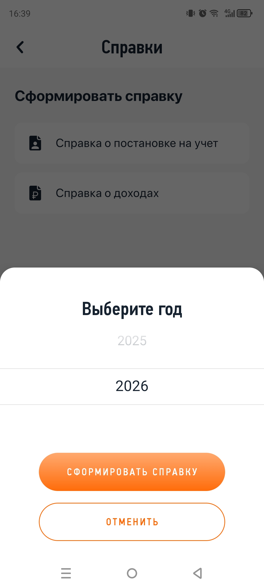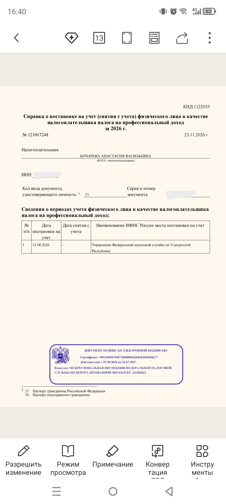

### Как сняться с учета
Если вы больше не хотите быть налогоплательщиком налога на профессиональный доход, вы можете **в любой момент сняться с учета.** К примеру, в компании действует строгая политика о наличии ИП или самозанятости. 

**Для снятия с учета:**
1. Перейдите в раздел **Прочее → Профиль.**
2. Нажмите кнопку **Сняться с учета.**
3. **Укажите причину** снятия с учета.

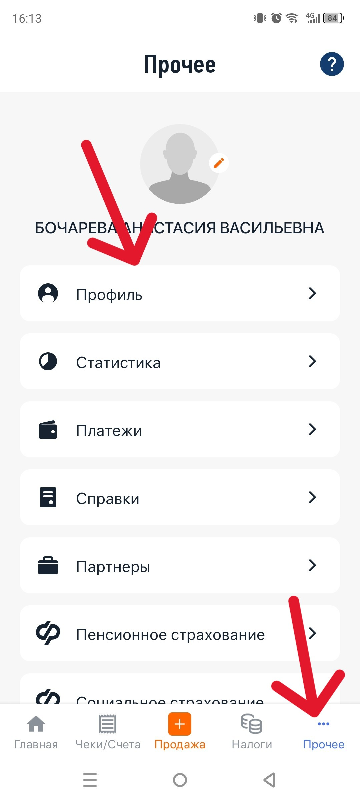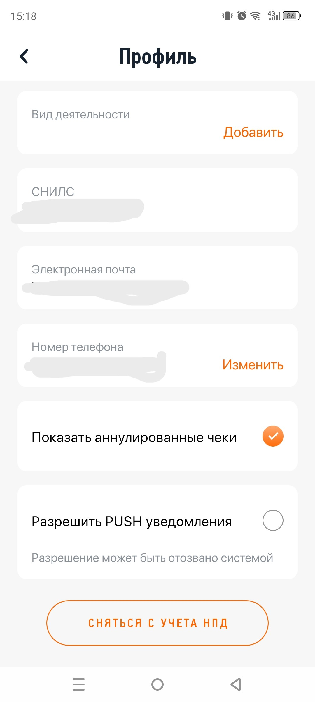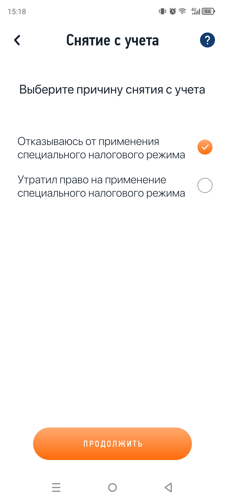

Больше ничего делать не нужно. При этом необходимо оплатить налоги, которые вам начислили за период работы. Если сняться с учета, **начисленный налог все равно необходимо уплатить.**

В любое время можно заново зарегистрироваться в качестве самозанятого. Процедура регистрации будет такой же, как и в первый раз.
