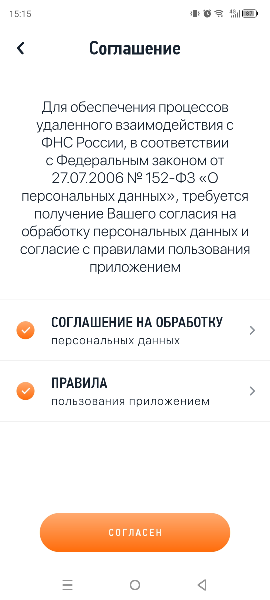
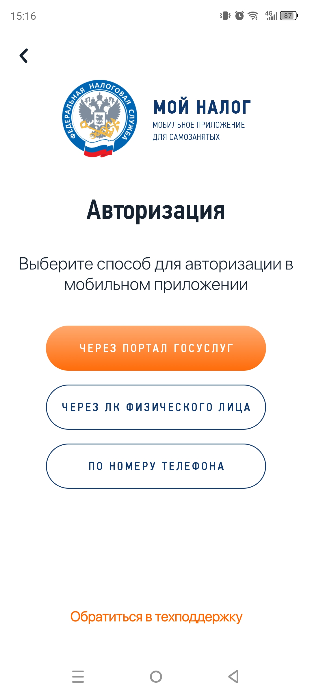

# Регистрация в качестве самозанятого и работа в приложении «Мой Налог»
> [!IMPORTANT]
> Если вы оказываете услуги (фриланс, репетиторство, сдача жилья и т. п.), оформите самозанятость. Так вы будете работать официально: клиенты смогут с вами сотрудничать без рисков, а у налоговой не возникнет вопросов.

## Оглавление
1. Что дает статус самозанятого
2. Что нельзя делать на НПД
3. Какие еще есть нюансы оформления самозанятости
4. Регистрация в приложении Мой Налог
5. Работа в приложении Мой Налог
   - Как начать принимать платежи
   - Как выставить счёт клиенту
   - Как оформить чек после оплаты
   - Как оплатить налог
   - Как сняться с учета

## Что дает статус самозанятого

Вы становитесь плательщиком налога на профессиональный доход (НПД):
- 4 % — если получаете оплату от физлиц;
- 6 % — если работаете с юрлицами и ИП.
Всё ведётся в приложении «Мой Налог»: вы выставляете счета и чеки, платите налог, получаете справки. Расчёты идут автоматически — бухгалтер не нужен.

## Что нельзя делать на НПД 
> [!WARNING]
> Перед тем как начать, сверьте свою деятельность со списком запретов — нарушение любого из них ведёт к потере статуса НПД/

**Самозанятым нельзя:**
- перепродавать чужие товары;
- продавать подакцизные или маркированные товары;
- добывать и продавать полезные ископаемые;
- работать по агентским, комиссионным и договорам поручения;
- заниматься майнингом и операциями с цифровой валютой;
- сдавать в аренду нежилые помещения;
- оказывать услуги текущему или бывшему работодателю (если с увольнения прошло менее двух лет);
- совмещать НПД с другими налоговыми режимами;
- нанимать сотрудников по трудовым договорам.

## Какие еще есть нюансы оформления самозанятости

- Лимит дохода — 2,4 млн рублей в год, это относится только к доходу за профессиональную деятельность, по которой вы выставляется счета. Личные переводы (зарплата, возврат долга, продажа личного имущества) не влияют на лимит.
- Доработка товара — не перепродажа. Если вы изменили вещь (например, расписали кружку или сшили из ткани изделие), это считается продуктом собственного производства — продавать можно.
- Риск переквалификации в трудовые отношения. Регулярные выплаты в одни и те же даты, работа на одном месте заказчика и отсутствие актов могут вызвать вопросы налоговой. Лучше фиксировать результат актом и избегать признаков «скрытой зарплаты».
- Сроки формирования чека. При наличной оплате чек нужен сразу, при безналичной — не позднее 9‑го числа месяца, следующего за месяцем поступления денег.
- Нет страхового стажа. Работа на НПД не засчитывается в пенсионный стаж — его можно формировать только через добровольные взносы в СФР.

## Регистрация в приложении Мой Налог

Процесс регистрации в качестве самозанятого осуществляется одним из следующих способов:

- через мобильное приложение ФНС России «Мой налог»;
- через личный веб-кабинет «Мой налог», размещенный на сайте ФНС России;
- через любую кредитную организацию или банк, осуществляющие информационное взаимодействие с ФНС России;
- через Единый портал госуслуг.

Подробная информация о регистрации в качестве самозанятого и работе в приложении Мой Налог указана на [сайте ФНС](https://npd.nalog.ru/app/). Рассмотрим регистрацию в приложении с авторизацией через Госуслуги. 

Скачайте приложение в [GooglePlay](https://play.google.com/store/apps/details?id=com.gnivts.selfemployed&hl=ru) или [AppStore](https://apps.apple.com/ru/app/мой-налог/id1437518854?l=en-GB).

 

Откройте приложение и нажмите "Далее", подтвердите согласие с Соглашением на обработку персональных данных и Правилами пользования приложением. На третьем экране выберите "Стать самозанятым". 
 
 
 
 
 

 
Выберите способ авторизации Через портал Госуслуг. Вы будете направлены на окно ввода логина и пароля для портала Госуслуг.
 
 

Ваше заявление на регистрацию в качестве плательщика НПД принято в работу. Срок обработки заявления до 5 рабочих дней. На практике — быстрее, от нескольких минут до нескольких часов.

## Работа в приложении Мой Налог
### Как начать принимать платежи

Перед тем как выставлять счёт, укажите, куда будете получать деньги:
1. Откройте раздел «Прочее» (в правом нижнем углу) → «Платежи».
2. В блоке «Получение средств» выберите «По расчётному счёту».
3. Если планируете получать оплату на карту физлица, всё равно выберите «По расчётному счёту» и укажите данные лицевого счёта.
4. Введите реквизиты (БИК и номер счёта) — их можно взять в приложении вашего банка.
5. Нажмите «Сохранить».

### Как выставить счёт клиенту
Далее необходимо сформировать счет на оплату. Для этого на главном экране внизу нажмите на оранжевую кнопку + Продажа. 

Укажите наименование услуги – к примеру, монтаж печи Абат. 
Укажите согласованную стоимость услуги. 
Нажмите на кнопку Юридическому лицу или ИП.
 

Укажите ИНН компании. 
Нажмите кнопку Найти – название компании подтянется по ИНН. 
После этого нажмите на кнопку Выдать счет. 
Ссылку на счет направьте в штаб или бухгалтеру:

Перейдите в раздел Чеки/Счета – Счета, зайдите в сформированный счет. 

В счете нажмите на кнопку 3 точки внизу посередине и выберите Отправить ссылку на счет. Скопируйте ссылку и отправьте ее в штаб или бухгалтеру. 

### Как оформить чек после оплаты
 
Дождитесь оплаты счета. После оплаты сформируйте чек и отправьте ссылку на чек в штаб или бухгалтеру: 
Перейдите в раздел Чеки/Счета – Счета, зайдите в сформированный счет. 
В счете нажмите на кнопку 3 точки внизу посередине и выберите Сформировать чек или Отметить оплаченным. Сформируется чек. 
Открыть чек можно из раздела Чеки/Счета – Чеки. Зайдите в чек и нажмите кнопку Отправить. 

### Как оплатить налог

### Как сняться с учета

Выберите Отправить ссылку на чек. Скопируйте ссылку и отправьте в штаб или бухгалтеру.

     

