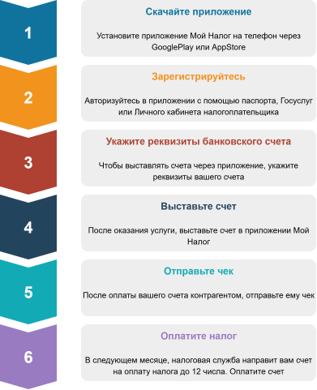

# Регистрация в качестве самозанятого. Работа с приложением Мой Налог
> [!IMPORTANT]
> Если вы регулярно оказываете услуги физическим и юридическим лицам, вам необходимо оформить это официально. Работа на фрилансе, репетиторство, сдача жилья, различные подработки — для этого нужно оформить самозанятость. Ваши клиенты смогут работать с вами официально, а у налоговой службы не будет вопросов ни к вам, ни к вашим контрагентам.
 
Когда вы регистрируетесь как самозанятый, вы встаете на учет в качестве плательщика НПД — налога на профессиональный доход со ставкой 4% при приеме платежей от физических лиц, и 6% при приеме платежей от юридических лиц. Все операции доступны в приложении Мой Налог: выставление счетов и чеков, оплата налога, получение справок. Вам не нужны другие ресурсы или помощь бухгалтера — все рассчитывается автоматически.

 
 
 

> [!WARNING]
> Самозанятым нельзя:
> - Перепродавать чужие товары
> - Продавать подакцизные или маркированные товары
> - Добывать и продавать полезные ископаемые
> - Выступать посредником по агентским договорам, договорам поручения или комиссии
> - Заниматься майнингом и куплей-продажей цифровой валюты
> - Сдавать в аренду нежилые помещения
> - Оказывать услуги текущему работодателю или бывшему менее чем два года назад
> - Совмещать НПД с другими налоговыми режимами
> - Нанимать сотрудников по трудовым договорам

## Оформление самозанятости

Процесс регистрации в качестве самозанятого осуществляется одним из следующих способов:

- через мобильное приложение ФНС России «Мой налог»;
- через личный веб - кабинет «Мой налог», размещенный на сайте ФНС России;
- через любую кредитную организацию или банк, осуществляющие информационное взаимодействие с ФНС России;
- через Единый портал госуслуг.

Подробная информация о регистрации в качестве самозанятого и работе в приложении Мой Налог указана на [сайте ФНС](https://npd.nalog.ru/app/). 

###
