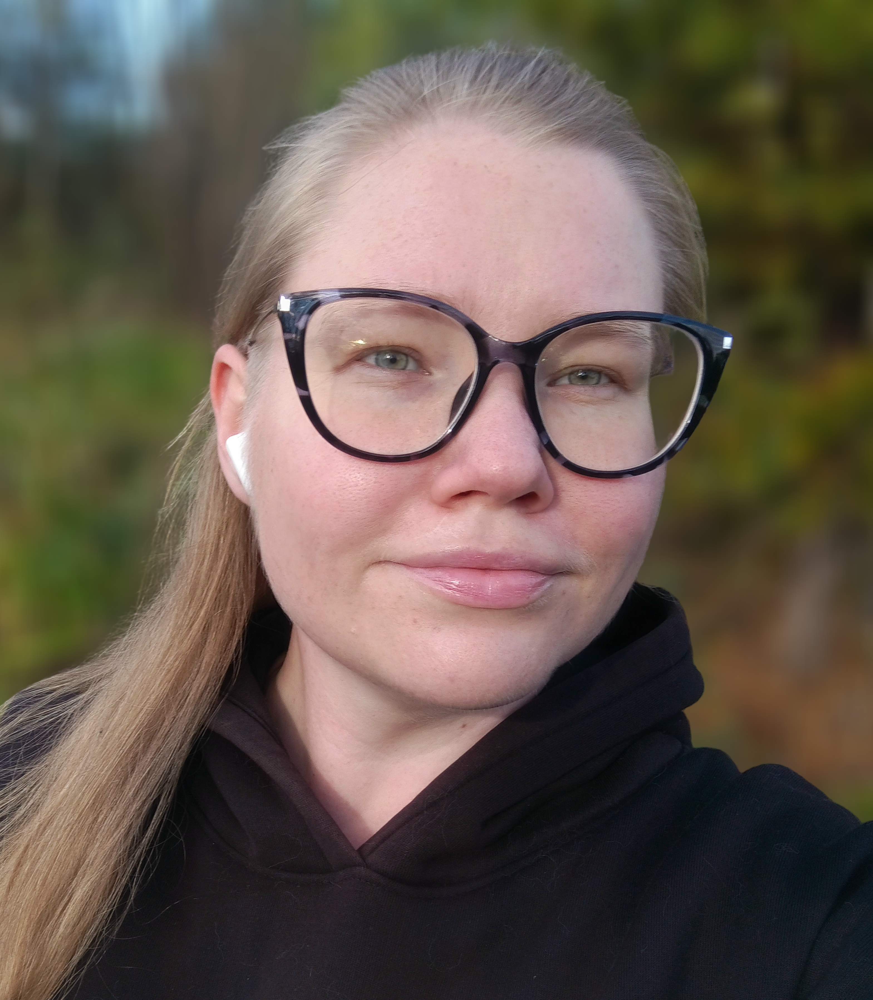

## Обо мне  

Меня зовут Анастасия, мне 27 лет, и сейчас я ищу работу. Хочу немного рассказать о себе и своем опыте.  

**Методист и автор баз знаний:** 3500+ часов корпоративного обучения, 80+ инструкций и регламентов в базах знаний. Перевожу сложные процессы в понятные документы и обучающие материалы.
 
 

## Инструменты
WordPress, Outline, ПланФикс, Confluence, Markdown, Microsoft Office, YandexGPT

## Навыки
- Разработка пользовательской документации, инструкций и регламентов.
- Разработка и запуск программ адаптации. Проведение вебинаров, тренингов и презентаций продукта.
- CustDev: разработка сценария, проведение и анализ интервью.
- ИИ-инструменты: генерация черновиков, редактирование текстов, структурирование информации.

## Контакты
bocharevaav@gmail.com
