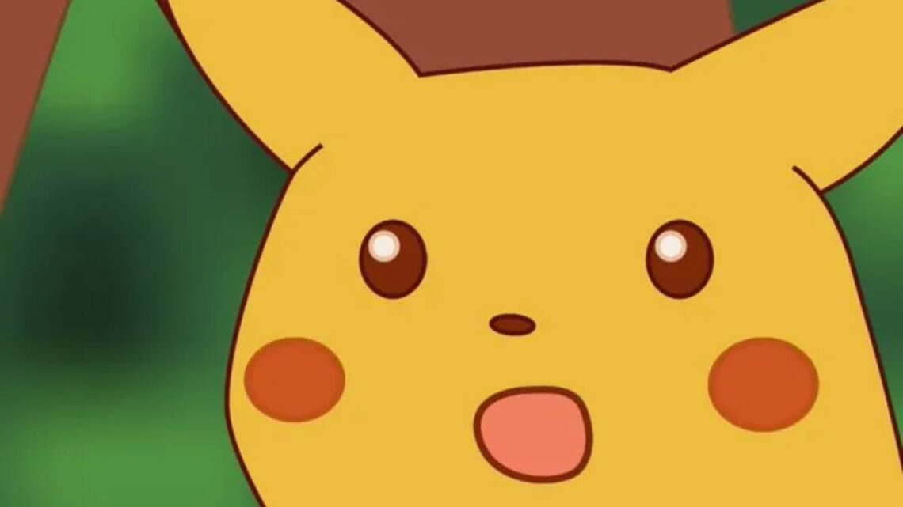

# Снижение веса: с чего начать

## Для чего вам худеть? 
Несколько лет я подходила к этому вопросу с точки зрения эстетики. И это один из мотивирующих факторов. Но можно выглядеть красиво и ухоженно и с избыточным весом. А главная причина становиться стройнее, которая зачастую упускается из вида — это состояние здоровья. __Ожирение — это болезнь,__ которая влечет за собой многие последствия: рак, диабет 2-го типа, сердечно-сосудистые заболевания, болезни печени и почек. Источник: [данные ВОЗ](https://www.who.int/ru/news-room/fact-sheets/detail/obesity-and-overweight).
Так что снижение веса — это то, что поможет вам быть здоровым сейчас, и через много лет. 

Мой __wake up call__ прозвучал в 2025 году — сначала проблемы со здоровьем и последующая за этим операция. Некритичная ситуация, и сейчас все в порядке, но тогда стало страшно. И уж точно не хотелось доводить до более серьезных проблем — а на горизонте призрачно маячил рак. Пока призрачно.
Потом в декабре врач прописала уколы семаглутида, и это было еще одно подтверждение реальности происходящего — я живу с ожирением, уже есть сопутствующие диагнозы. Ожирение — это болезнь, и мне прописали лекарство. То есть, вы хотите сказать, что когда врачи говорили, что мои проблемы со здоровьем из-за избыточного веса — это реально были проблемы от избыточного веса? А не предвзятость врачей по отношению к толстым людям?

 

 _Мое лицо в момент осознания, что избыточный вес — это заболевание. И от него появляются другие заболевания._

 
 
 
 
 

## С чего начать
Я поняла, что откладывать снижение веса на прекрасное далекое будущее больше нельзя, потому что без снижения веса этого будущего может и не случится. С уколов не хотелось начинать — я же еще не пробовала сама, наверное, начать стоит без них? Но начать что и как? В моей голове была обрывочная каша из "бегать по утрам", "есть салаты и куриную грудку", "заниматься спортом", "сложно тяжело ой-ей". Предположу, что у многих людей похожие ассоциации. Я загуглила "с чего начать худеть", и любезная Алиса AI мне выдала информацию про дефицит калорий, бытовую активность и тренировки. Пойдем по порядку. 

## Не надо худеть. Надо пересмотреть образ жизни

### Дефицит калорий

### Бытовая активность

### Тренировки 

Это про образ жизни — как я планирую свое питание, как я ложусь спать и просыпаюсь, как я отдыхаю и восстанавливаюсь после тренировок. У меня впереди еще долгий путь. Но и сейчас, оглядываясь на этот год, я вижу, что проделана огромная работа. И горжусь собой. 

- что понадобится (весы, дневник питания, расчёт калорийности);
- пошаговая процедура: рассчитать норму калорий → определить белки/жиры/углеводы → составить меню на неделю → встроить контрольные точки (взвешивание раз в неделю);
- таблица: пример дневного рациона или сравнение источников белка;
- блок-схема в draw.io: «что делать, если вес встал»;
- чек-лист в конце.

